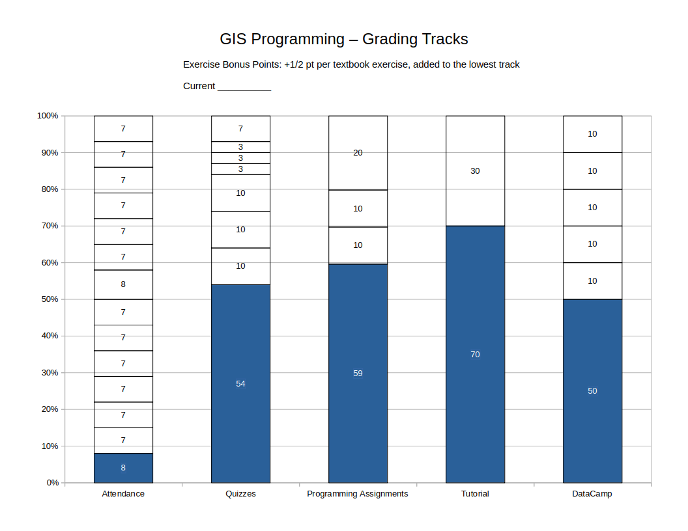

# Assignments & Grading

This course will make use of a variant of [Specification Grading](https://sites.temple.edu/hachadoorian/specification-grading/). This means that many assignments will be graded Complete/Incomplete or assigned a provisional grade, and in some cases will merely be returned with comments. Assignments marked Incomplete or not awarded full points may be revised and resubmitted. Quizzes can be retaken until passed, unless otherwise specified.

You will earn points along several **tracks**. Each track is worth up to 100 points. You must progress along ***ALL*** tracks to be successful in this course. Your final grade is based on the ***lowest*** score earned along any track.

Tracks proceed linearly and assignments usually need to be completed in the designated order. For example, for quizzes, the material is cumulative, and you can't earn credit for Quiz 4 if you haven't passed Quiz 3. Often, later assignments in a track presume knowledge you will have acquired by completing earlier assignments.

Some assignments proceed in milestones. In each case, you must proceed along the milestones in order. For example, for a term project, there will often be an initial topic statement, followed by an annotated bibliography (for a paper) or analysis plan (for an analytical project), a draft, and a final report. You cannot submit an annotated bibliography if your topic statement has not been approved, and you cannot submit a draft or final report if you haven't submitted an annotated bibliography or analysis plan.

Grading will conform to the following scale:

* A 93%+
* A- 90 - <93%
* B+ 87 - <90%
* B 83 - <87%
* B- 80 - <83%
* C+ 77 - <80%
* C 73 - <77%
* C- 70 - <73%
* D+ 67 - <70%
* D 63 - <67%
* D- 60 - <63%
* F <60%

## Attendance

0-100 points. Your attendance score is a straight percentage of class sessions you are present for.

This course meets once a week. Missing *any* class meetings will hamper your ability to complete the work in this course. High-performing students tend to be the ones who attend all class meetings. Struggling students may be struggling for a variety of reasons, but for many of them, lack of attendance is a contributing factor. Your attendance percentage will also indicate the maximum final grade you can earn in this course. If you miss 3 classes, you have attended 78.6% of class meetings. Accordingly, your final grade will not be higher than a C+, *regardless of any other work completed*.

An exception is that missing one class (attending 92.9% of class meetings) will still earn an A in the Attendance Track.

## Quizzes

54 (base score) + 10 points for each of Quiz 1-3 + 3 points for each of Quiz 4-6.

Each topic will conclude with a short, graded programming quiz, beginning with the third week of class. The difficulty level should be comparable or easier than the weekly exercises, so if you complete the exercises, are present for in-class review, and review the exercises afterwards, you should be well-prepared for the quizzes.

The quizzes will be taken in class with pencil and paper. You may use a printed "cheat sheet" of Python commands and functions. The sheet ***must*** be printed out. You ***may not*** use your laptop or phone during the quiz.

Quizzes may—in fact, *must*—be retaken until they are passed. The quizzes are cumulative. Solving Quiz 5 will use knowledge demonstrated on Quizzes 1-4. Accordingly, you cannot earn points for later quizzes unless you complete all earlier quizzes. If you do not pass a quiz, you may retake it the following week. You will keep taking the quiz until you complete it. When you complete it, you will earn full points for it. There is no penalty for requiring multiple attempts to pass a quiz.

Quizzes cannot be rescheduled outside of class time. If you miss class one week, you have given up one opportunity to progress on the quizzes track. The final week of classes will be the last quiz round.

Until at least Week 9, quizzes will be given at the beginning of class, before lecture. It is possible that most or all students will have completed the quizzes track by that time in the semester. When we move on to Student-Led Tutorials (Week 10 or 11), class will start with the tutorials, and quizzes will be moved to the end of the class period. At that point, students who have completed the quizzes track may leave class early.

### Quiz 1-3 (10 points x three)

* Quiz 1: Python Basics, Strings
* Quiz 2: Python Basics, Math
* Quiz 3: Lists

### Quiz 4-6 (3 points x three)

* Quiz 4: Conditionals
* Quiz 5: Loops
* Quiz 6: Defining Functions

## DataCamp

50 (base score) + 10 for each DataCamp course completed.

This course will make use of online exercises provided by DataCamp. You must use your Temple email address to register for a premium account (free using a link provided by the instructor). You will be required to complete five assigned DataCamp courses:

* [Introduction to Python](https://www.datacamp.com/courses/intro-to-python-for-data-science)
* [Intermediate Python](https://www.datacamp.com/courses/intermediate-python)— In addition to control of flow, this course introduces data visualization and Pandas, which will be covered in greater depth later
* [Data Manipulation with Pandas](https://learn.datacamp.com/courses/data-manipulation-with-pandas)
* [Introduction to Functions in Python](https://www.datacamp.com/courses/introduction-to-functions-in-python)
* [Working with Geospatial Data in Python](https://learn.datacamp.com/courses/working-with-geospatial-data-in-python)

You will have premium access to DataCamp courses for six months. You may choose to complete any additional courses you want to throughout the semester, and for a few weeks beyond the end of the semester. The following courses are not assigned but may be of interest:

* [Python Toolbox](https://app.datacamp.com/learn/courses/python-toolbox)
* [Introduction to Network Analysis in Python](https://www.datacamp.com/courses/network-analysis-in-python-part-1)
* [Introduction to Data Visualization with Seaborn](https://app.datacamp.com/learn/courses/introduction-to-data-visualization-with-seaborn)

Students who have previously used DataCamp and already completed any of the required courses (the completion date on your DataCamp certificate is prior to this semester) should either retake the course if they feel they need a refresher or select another DataCamp Python course to do instead. Please ask me if you have any questions.

### Grading

Full credit (10 points) is awarded for on-time completion. Late submissions will be marked down 1 point for every two calendar days it is late, to a minimum of 5 points.

## Programming Assignments

59 (base score) + 10 for Assignments 1 and 2 + 20 for Assignment 3.

These will be two short programming assignments that will build on material learned in the exercises and classroom demonstrations, followed by a longer analysis pipeline designed by the student.

### Assignment 1: Vector Operations (10 points)

This assignment is based on [Lab 6 - Vector Operations](https://github.com/temple-geography/fundamentals-arcgis-pro/blob/master/Lab_06_Vector_Operations.md) from GUS 5062 - Fundamentals of GIS. That lab exercise uses vector operations that you should be familiar with such as buffering, intersection, erasing, etc., to identify an area in Philadelphia suitable for a new store selling healthy foods. Many of you will have taken GUS 5062 and completed Lab 6 in ArcGIS Pro. Now you will see how to automate it using Python. For those of you unfamiliar with the exercise, reading the assignment prior to starting will give you a little more context.

A shapefile of the Philadelphia city limits and SEPTA routes and a geopackage of neighbhorhoods are provided creating the final map of the target areas. `City_Limits.shp` and most analysis files are in Pennsylvania State Plane South. `SEPTAGISRegionalRailStations_2016.shp`, `SEPTARoutesSpring2016.shp`, and `philadelphia_neighborhoods.gpkg` are in WGS84 and will have to be reprojected to PA State Plane South.

#### Deliverables

* A Jupyter notebook with narrative describing the steps being completed and the code to complete the analysis, along with maps of the results of intermediate spatial operations.
* The area of the largest contiguous zone that satisfies all criteria, output by a code cell at the end of the notebook.
* A map of the final layer of candidate zones (all candidate areas, not just the largest one), with a basemap and SEPTA routes, output by a code cell at the end of the notebook.

#### Evaluation

One point will be awarded for each of the following:

1. Create a notebook that runs to completion with no errors.
2. Read all analysis files from a subfolder of the notebook folder, or a **relative path** to a datafolder of your choice. Filepaths should be constructed as the concatenation of a **data** folder and the **filename**, with optional subfolders within the data folder.
3. Use course coding conventions throughout, including using `lowercase_with_underscores` for all variable names.
4. Correctly reproject SEPTA Regional Rail Stations shapefile (and SEPTA Routes and the Philadelphia Neighborhoods, if used).
5. Correctly buffer Healthy Corner Stores and Farmers Markets to 1200 feet. Display a map of the buffer just created.
6. Correctly buffer SEPTA High Speed and Regional Rail Stations to 2000 feet. Display a map of the buffer just created.
7. Construct correct inclusion zone. Display a map of the inclusion zone.
8. Correctly combine inclusion and exclusion zones to create a layer of candidate areas. Display a map of the target areas, along with regional rail routes, on top of a basemap of the Philly city limits or neighborhoods.
9. Correctly add an area column to layer of candidate areas. Output the area of the *largest* target area using the `max` method on the area column or the `sort_values` or `nlargest` data frame methods.
10. Provide adequate comments throughout your code.

### Assignment 2: Raster Operations (10 points)

This assignment is based on [Lab 7 - Raster Operations](https://github.com/temple-geography/fundamentals-arcgis-pro/blob/master/Lab_07_Raster_Operations.md) from GUS 5062 - Fundamentals of GIS. That lab exercise uses raster operations that you should be familiar with such as mosaicking, masking, zonal statistics, etc., to calculate the mean percent impervious surface for municipalities in Delaware County, PA. Many of you will have taken GUS 5062 and completed Lab 7 in ArcGIS Pro. Now you will see how to automate it using Python. For those of you unfamiliar with the exercise, reading the assignment prior to starting will give you a little more context.

#### Deliverables

* A Jupyter notebook with narrative describing the steps being completed and the code to complete the analysis.
* A table of median impervious surface and mean percent slope by municipality.
* A list of the municipalities with median impervious surface of at least 50% or mean slope of at least 5%, and a list of municipalities that meet *both* criteria.
* A map of the terrain that simultaneously shows the hillshade and elevation with the grid cells with a percent impervious surface > 50% overlain.
* A choropleth map of the median percent impervious surface by municipality.

#### Evaluation

Details forthcoming.

### Assignment 3: Analaysis Pipelines (20 points)

For this assignment, you will perform a more complex analysis of your own design in a Jupyter notebook which, broadly, accomplishes the following:

1. Access data remotely, either via API or download and unzip.
2. Perform geospatial analysis using geopandas, rasterio, PySAL, or other Python packages. Common geospatial operations such as buffering, nearest neighbor, zonal statistics, etc., can be considered.
3. Create post-processing output: this could include maps, tables, and should include a narrative discussion of the results.

Thus, the notebook should implement a full analysis pipeline including from data acquisition, exploratory data analysis and visualization, substantive analysis, and visualization and discussion of results.

#### Deliverables

* A Jupyter notebook with narrative describing the motivating idea, analysis being undertaken, steps being completed, and the code to complete the analysis.

#### Evaluation

Details forthcoming.

## Student-Led Python Package Tutorials

70 (base score) + up to 30 points as detailed below.

Students will work in teams of 3-4 to learn about a Python package and design a tutorial workshop to present to the class.

The tutorial should be structured as an approximately one hour workshop. The first few minutes can be devoted to an overview of the problem space. What business need are you trying to meet, or what analytical problem are you trying to solve? This *may* be accompanied by slides, but this is not a requirement, and definitely do not do several minutes of text-heavy slides. Following should be the workshop. This should be hands-on using Python scripts or Jupyter notebooks. The students should be given a workbook with clear instructions. You should live demo the code. Code should be clearly explained. And your team will circulate and help students with individual challenges.

The range of possible packages is quite wide. A list of packages of interest will be provided separately and discussed in class. Broadly, candidate packages are those used for spatial analysis, raster analysis, statistical visualization, geovisualization, and GIS-adjacent analyses such as machine learning and network analysis.

The team will need to read documentation, technical blogs, or other tutorials to learn about their topic, and then prepare their own tutorial workshop for the class. The workshop may be based on other tutorials that you find, but should be your own work. At the very least, you should make use of a different dataset than any tutorial that you consult when teaching yourself the topic. Try to use data of real-world interest to the class. Using data specific to Philadelphia or nearby regions is a good choice.

The workshop does *not* require Powerpoint. It can be entirely demo. If you do want to open up with an overview of the topic, keep it to five minutes max, and slides are still optional. Do not use slides for code.

Team members should rotate roles. Each person should have a chance doing teaching demo at the front of the room. Other team members should be circulating among the class, helping troubleshoot issues that the students are encountering.

### Workbook

Your workshop should be accompanied by a workbook. There are two possibilities:

* We will be working in Jupyter notebooks throughout the semester, and your tutorial workbook can be a Jupyter notebook.
* Alternatively, your workbook could be written in [Markdown](https://guides.github.com/features/mastering-markdown/), and you can provide Python scripts (`*.py`).

If the package you demo is not in our course Anaconda environment, the workbook should include package installation instructions. Packages should be installed using `conda`, not `pip` or other methods, unless you are demoing a package this is not available in a conda channel.

Data downloads may be included in the code, if reasonably small. However, if the data needed is larger than about 10 or 20GB, you should include download instructions for the students to download the data ahead of time.

The workbook should also include links to documentation or learning resources related to your topic. These should be included in a reference section, but also consider including live links at appropriate points in the instructions.

The workbook should have your names on it. This should be a document that you would feel comfortable posting publicly as a way to demonstrate your facility with these tools. It is also something that you would consider using to run a public workshop at a user conference or industry event.

**Special instructions for Markdown workbooks:**

The workbook may include screenshots. Code should be included as text, not as a screenshot of a code editor! 

You should export the Markdown file to PDF. VS Code has a built-in Markdown preview, but no exporter. I will test some Markdwon export extensions and provide a recommendation.

### Workshop

The workshop itself should be practical, and focused on accomplishing a particular outcome, which may be a data management outcome or an analytical outcome. Walk the students through steps to learn how to accomplish the goal. Examples should be clearly explained. Consider having a small number of additional exercises at the end, for which answers are not provided.

During the workshop itself, you should provide live demos or code walkthroughs. Then, as the students work through the workbook, you should circulate among the class, answering questions and helping troubleshoot. Bring the class back together at the end, perhaps showing the final intended result, or showing a further analysis or procedure that interested students could pursue on their own.

### Deliverables

* **Slides (if any) or presentation outline**. These should be provided to Prof. Hachadoorian approximately one week before the tutorial. Slides can be sent via email (PDF preferred) or shared as Google Slides.
* **Preparation Instructions**. Send instructions to the class for anything that has to be downloaded or installed at least 48 hours prior to the workshop.
* **Workbook**. Jupyter notebook or PDF. A PDF should probably be about 10 pages of text. With screenshots, code listings, and sources, it could easily be over 20. The exact length is a little difficult to predict ahead of time.

### Evaluation

* (70 points) Base score.
* (5 points) Team sends installation/data download instructions to the class at least 24 hours before their workshop.
* (10 points) Tutorial workbook.
* (10 points) Workshop is well-structured and leaves class with a useful first exposure to the topic.
* (5 points) Team can knowledgeably respond to questions from the class.

Note that the workbook is the only part of the tutorial that can be revised. The rest of the requirements depend on preparing for and giving the workshop on the scheduled day. If the team is unprepared or outright misses the scheduled day, it cannot be made up.

## Exercises

Up to 4 bonus points (1/2 point per exercise x eight).

During the first half of the semester, exercises will be assigned each week based on that week's lecture topic. Only one problem from each exercise will be evaluated, and they will earn you bonus points in the Programming Assignments track. We may go over some of the exercises at the beginning of the following class. In order to benefit from them, you must have completed them before we review them in class. Accordingly, exercises will not be accepted late.

The exercises generate bonus points that will be added to a student's lowest individual grading track.

